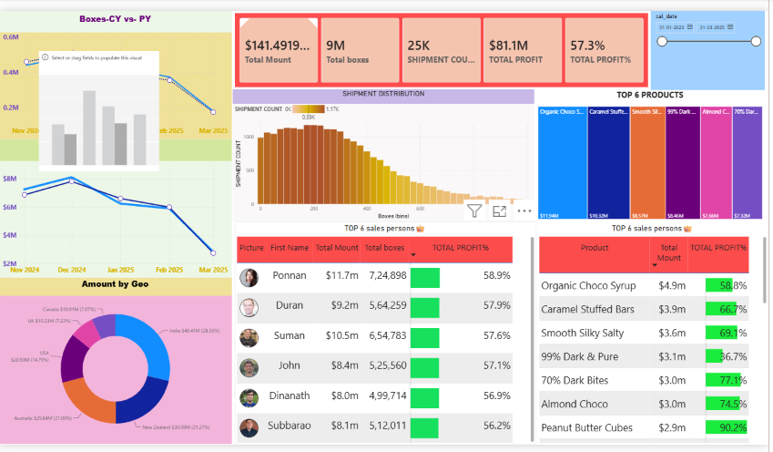

# Chocolate-Sales-PowerBI-Dashboard
Interactive Power BI sales dashboard using Star Schema data modelling and DAX measures

## Project Overview
An interactive Power BI executive dashboard analyzing *$141.49M in total sales, **9M boxes shipped, and *$81.1M in total profit (57.3% profit margin)** across 25,000+ shipments, products, sales representatives, and geographic regions.

## Tools & Techniques Used
* *Power BI Desktop:* Executive KPI cards, conditional formatting data bars, donut charts, trend comparisons (Current Year vs. Previous Year), and dynamic date slicers.
* *Star Schema Data Modeling:* Connected a central shipments fact table with calendar, locations, people, and products dimension tables.
* *DAX Measures:* Custom calculations for Total Amount, Total Boxes, Shipment Count, Total Profit, Total Profit %, and Boxes CY vs. PY.
* *Power Query:* Data cleaning, transformation, and standardization.

## Key Business Insights
* *Top Performers:* Identified top revenue-generating sales representatives (led by Ponnari at $11.7M) and highest-grossing products (led by Organic Choco Syrup at $4.9M).
* *Profitability:* Tracked overall profit margin at *57.3%* and highlighted product-level profit percentage differences using conditional data bars.
* *Geographic & Trend Analysis:* Evaluated shipment distribution and year-over-year box volume trends across key markets.
